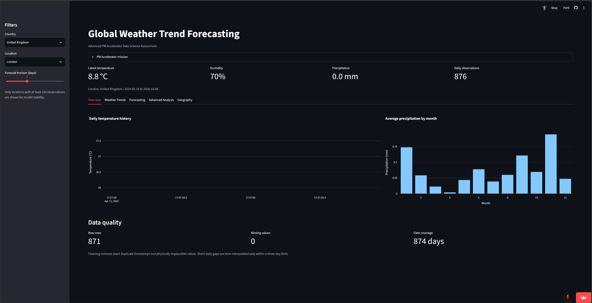

# Global Weather Trend Forecasting — Advanced Assessment

An advanced data-science assessment built from the **Global Weather Repository** dataset. The project combines time-series forecasting, anomaly detection, air-quality analysis, feature importance, and spatial analysis in an interactive Streamlit dashboard.

## Live Demo

[View the Streamlit Dashboard](https://global-weather-trend-forecasting-qpqho4wjogcbp4voeq37zt.streamlit.app/)
## What the project covers

### Advanced EDA
- Multivariate anomaly detection with Isolation Forest
- Temperature, precipitation, weather-variable and air-quality exploration
- Monthly/seasonal trend views and correlation analysis

### Forecasting with multiple models
The dashboard compares:
- Seasonal Naive (7-day baseline)
- Ridge Regression with lag/rolling/calendar features
- Random Forest Regressor
- Gradient Boosting Regressor
- Equal-weight ensemble of the three learned models

Evaluation uses a **chronological 80/20 holdout split**, not a random split. This keeps later observations out of training and avoids time-series leakage. Metrics include MAE, RMSE and MAPE.

### Unique analyses
- **Weather trend analysis:** multi-year temperature and precipitation patterns
- **Environmental / air-quality analysis:** PM2.5 correlations with weather variables
- **Feature importance:** Random Forest impurity importance + permutation importance
- **Spatial analysis:** global map of the latest observations
- **Geographic patterns:** country and continent-level comparisons

> Important limitation: the dataset spans roughly 2.4 years. That is enough for multi-year weather analysis and forecasting, but not enough to make strong claims about long-term climate change.

## PM Accelerator mission
PM Accelerator's mission is to make industry-leading tools and education available to individuals from all backgrounds, helping level the playing field for future PM leaders. It focuses on giving aspiring and experienced PMs access to industry leaders, the right PM ecosystem, and AI product management skills.

## Project structure

```text
weather_advanced_assessment/
├── app.py
├── data/
│   └── GlobalWeatherRepository.csv
├── src/
│   ├── preprocessing.py
│   ├── forecasting.py
│   ├── anomaly_detection.py
│   ├── feature_importance.py
│   └── geo.py
├── notebooks/
│   └── advanced_weather_analysis.ipynb
├── outputs/
│   └── benchmark_metrics.csv
├── REPORT.md
├── DEMO_SCRIPT.md
├── requirements.txt
└── README.md
```

## Run locally

```bash
python -m venv .venv
```

Activate the environment, then install dependencies:

```bash
pip install -r requirements.txt
```

Start the dashboard:

```bash
streamlit run app.py
```

## Data cleaning and preprocessing
The preprocessing pipeline:
1. Parses observation timestamps.
2. Removes exact location/timestamp duplicates.
3. Coerces quantitative columns to numeric values.
4. Rejects physically implausible humidity, temperature, pressure, precipitation, and wind values.
5. Aggregates duplicate-day observations at the location level.
6. Reindexes each location to a daily frequency and time-interpolates only short gaps of up to three days.
7. Builds lag, rolling-window, and cyclical day-of-year features for forecasting.

No future target value is used to construct a past training observation.

## Forecasting methodology
For a selected location, the target is daily temperature in °C. Model features include lags at 1, 2, 3, 7 and 14 days; 7- and 14-day rolling summaries; and sine/cosine day-of-year features.

The last 20% of feature-complete observations are held out as the test period. All model comparison metrics are calculated only on this future holdout period. The dashboard also produces recursive 3–14 day forecasts from the most recent data.

## Anomaly detection
Isolation Forest is trained on standardized temperature, precipitation, humidity, wind, pressure and PM2.5 measurements for the selected location. Approximately 3% of points are flagged as unusual. These are candidate anomalies, not automatically data errors.

## Feature importance
Two complementary techniques are shown:
- Random Forest impurity-based importance
- Permutation importance on a chronological holdout set

Using both reduces reliance on any one interpretation method.

## Notes on interpretation
- Correlation does not establish causality.
- PM2.5/weather relationships may differ substantially by geography and season.
- The dashboard is a data-science demonstration, not a replacement for an operational meteorological forecasting service.
- Because historical coverage is only about 2.4 years, the analysis intentionally avoids claiming long-term climate change trends.
